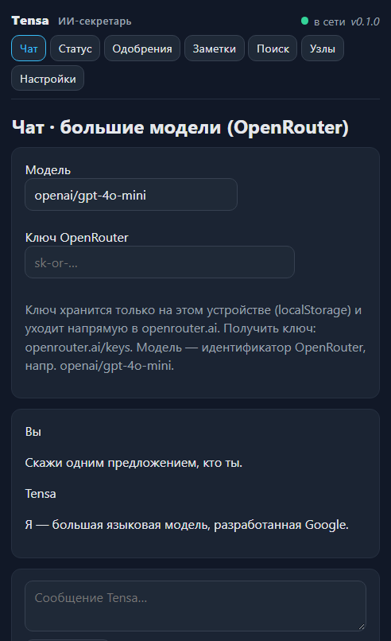
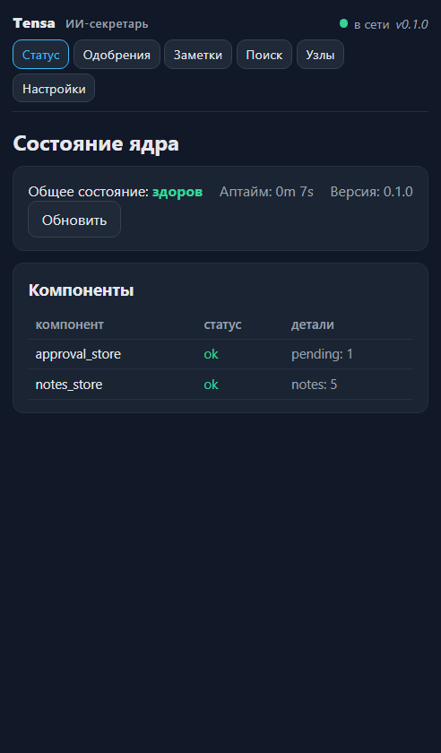

# Tensa

**Персональный ИИ-секретарь, который работает на ваших устройствах и делает только то, что вы одобрили.**

Tensa — self-hosted секретарь для одного человека: документы, почта, календарь, заметки,
контакты. Модель — локальная (llama.cpp, GGUF) или облачная (OpenRouter); всё, что меняет мир
за пределами приложения — отправить письмо, поставить встречу, запустить программу — проходит
через `ApprovalStore`: сначала одобрение владельца, потом выполнение, с аудитом.

Ядро — Rust-воркспейс из 17 крейтов (ядро, HTTP-сервер, CLI, память, обёртки
llama.cpp и whisper.cpp). Клиенты: **PWA** (Svelte 5),
**Android** (нативный клиент, APK) и **Windows-установщик** (ядро + CLI + Telegram-бот + PWA).
Синхронизация узлов (gRPC) — в разработке.

---

## Что уже работает

| Контур | Возможности |
|---|---|
| **HTTP-ядро** | `/health`, `/version`, заметки (CRUD + FTS5-поиск), очередь одобрений (approve/reject), SSE `/events`, календарь (guard конфликтов + ICS), почтовые аккаунты, `POST /query` (облако/локальная модель с fallback), приём модели эмбеддингов из APK |
| **Память** | иерархическая память (core/recall/archival, ADR-021), семантический поиск на `intfloat/multilingual-e5-small`: `tensa memory index / search / list / delete` (проверено на реальной модели) |
| **Файлы на дисках** | локальный индекс всех fixed-дисков (кроме системных каталогов): поиск по имени и содержимому PDF/DOCX/PPTX/XLSX/TXT/MD (FTS5). Запрос «найди договор …» отвечает списком файлов с путями; для остальных вопросов фрагменты подмешиваются в контекст модели |
| **Инструменты** | Telegram-бот «@your_tensa_bot» (`/status`, `/approvals`, `/approve`, `/reject`, inline-кнопки, сторож очереди), email через SMTP (lettre, STARTTLS/implicit TLS), документы PDF/DOCX/PPTX/XLSX/TXT/MD, Wake-on-LAN |
| **PWA** | Чат (через ядро), Статус, Одобрения, Заметки, Поиск, Настройки — Svelte 5, SSE, i18n ru/en, PWA-манифест, офлайн-оболочка |
| **Android (APK)** | Мобильный клиент: первый запуск с адресом сервера и токеном, dashboard, чат с пузырями, голос push-to-talk через ASR на ПК, запуск как на десктопе: окно сразу сворачивается, плавающий виджет поверх приложений, выбор любого системного микрофона (USB/Bluetooth/гарнитура), видимая кнопка «Назад», файлы на ПК (поиск + скачивание), одобрения, заметки, почта, календарь, настройки; ключей и моделей заранее нет |
| **Windows** | `TensaSetup.exe`: ядро + CLI + Telegram-бот + PWA + **модель e5-small в комплекте; модели речи скачиваются из «Настроек»**; ярлыки, деинсталлятор; ставится без админа в `%LOCALAPPDATA%\Tensa` |
| **Голос** | Кнопка микрофона в виджете: запись → локальный whisper (модель скачивается из «Настроек», офлайн) → текст в поле ввода; ~0.1–1.4 с после прогрева (постоянный ASR-worker, как в Handy) |
| **Виджет** | Прозрачное always-on-top окно: зелёная пилюля и лампочка **перетаскиваются мышью** (Pointer Events с захватом), разворот в HUD-панель |

## Модели

- **Эмбеддер памяти e5-small** (`intfloat/multilingual-e5-small`) — **в комплекте** установщика
  Windows и APK; работает офлайн, сеть не нужна.
- **Локальная LLM** — проектный квант [`TheStageAI/gemma-4-E2B-it-GGUF`](https://huggingface.co/TheStageAI/gemma-4-E2B-it-GGUF):
  **`gemma-4-E2B-it-XS-TS-Q3_K_S.gguf`** (~1.73 ГБ, самый лёгкий по памяти) в
  `~/.tensa/models`; модель скачивается одной кнопкой из «Настроек», SHA256 проверяется автоматически.
  Локальный инференс — llama.cpp внутри ядра.
- **Модели распознавания речи** — Whisper tiny/small q5_1/small + Nemotron/Parakeet/Canary (75–797 МБ) скачиваются из «Настроек»; small/Nemotron/Parakeet/Canary — с blob.handy.computer (Handy), tiny/small q5_1 — с Hugging Face whisper.cpp. Nemotron/Parakeet/Canary работают через отдельный runtime 	ensa-asr.exe (входит в установщик).
- **Модель ассистента** — локальная Gemma 4 E2B (~1.65 ГБ, скачивание из «Настроек») или OpenRouter google/gemma-4-26b-a4b-it (API-ключ вводится там же).
- **Большие модели** — OpenRouter: ключ в `~/.tensa/secrets.toml` (`[openrouter] credential = "sk-or-…"`)
  или `OPENROUTER_API_KEY`; чат PWA/APK идёт через ядро, ключ остаётся на ПК.
  Ключ выдаётся на https://openrouter.ai/keys.

## Быстрый старт

1. Скачайте `TensaSetup.exe` из [Releases](https://github.com/kostyuk230378-cmd/TENSA/releases) и установите.
2. Запустите ярлык **Tensa** — откроется браузер на `http://127.0.0.1:8765/app`
   (окно консоли держит сервер; закрыли — сервер остановлен).
3. На этом ПК вход **без токена** (loopback доверенный). Токен — только для телефона:
   `%USERPROFILE%\.tensa\pwa_token`.
4. Телефон: установите APK (Release или `http://<ip-пк>:8765/static/Tensa.apk`), в Настройках
   укажите адрес ядра (например `http://<ip-пк>:8765`) и тот же токен.
5. Проверка памяти на ПК:
   `tensa-cli.exe -c %USERPROFILE%\.tensa\config.toml memory index <файл>` →
   `tensa-cli.exe … memory search "запрос"`.

## Скачать

Актуальный релиз — **[v0.2.28](https://github.com/kostyuk230378-cmd/TENSA/releases/tag/v0.2.28)**:

| Платформа | Файл | Размер |
|---|---|---|
| Windows | [TensaSetup.exe](https://github.com/kostyuk230378-cmd/TENSA/releases/download/v0.2.28/TensaSetup.exe) | 220.4 МиБ |
| Android | [Tensa.apk](https://github.com/kostyuk230378-cmd/TENSA/releases/download/v0.2.28/Tensa.apk) | 228.1 МиБ |

Размеры дистрибутивов указаны в МиБ (1 МиБ = 1 048 576 байт).

## Скриншоты

## Сборка из исходников (Windows): LLVM/libclang

Крейт `tensa-whisper` собирается через `whisper-rs-sys`, которому на этапе сборки нужен
`libclang` (генерация биндингов bindgen). Без него `cargo test --workspace` и
`cargo build --workspace` падают на `whisper-rs-sys` с ошибкой вида «libclang not found»
(в CI на Ubuntu ставится `libclang-dev`, поэтому там дополнительных настроек не нужно).

Установка и настройка:

1. Установите LLVM: `winget install LLVM.LLVM` (или установщик со страницы релизов
   <https://github.com/llvm/llvm-project/releases>).
2. Пропишите переменную окружения — путь к каталогу с `libclang.dll`:
   `setx LIBCLANG_PATH "C:\Program Files\LLVM\bin"`.
3. Перезапустите терминал и проверьте: `echo $env:LIBCLANG_PATH`.

Если LLVM ставить не нужно, крейт можно исключить:
`cargo test --workspace --exclude tensa-whisper` — остальные 16 крейтов собираются
и тестируются без libclang.

## Тесты и качество

- `cargo test --workspace --exclude tensa-whisper` — **388 passed, 0 failed, 1 ignored**
  (50 тестовых бинарей); на CI (Ubuntu) полный `cargo test --workspace` — зелёный;
- feature-прогоны: `tensa-memory --features lance,fastembed` — **35 passed** (1 ignored),
  `tensa-llama --features native` — **36 passed** (2 ignored — требуют реальную GGUF-модель);
- `cargo clippy --workspace --all-targets -- -D warnings` — 0 предупреждений; `cargo fmt --check` — чисто;
- MSRV — 1.95; CI (GitHub Actions): fmt + clippy + tests, MSRV-проверка, memory-job (Lance + fastembed) — зелёные.

## Документация

- `BUILD_REPORT.md` — отчёт о сборке, артефактах, проверках и публикации в GitHub;
- `teh_doc/` — техническая документация: 21 ADR, 13 контрактов, 14 ТЗ, `FIN.md` (финальная сводка);
- `START_HERE.md` — инструкция AI-разработчику проекта;
- `PRODUCT DOC/` — продуктовая документация (PD_1–7), `Guide/` — руководства пользователя;
- `README_DOCS.md` — прежний индекс документации.

## Лицензия

MIT OR Apache-2.0.
